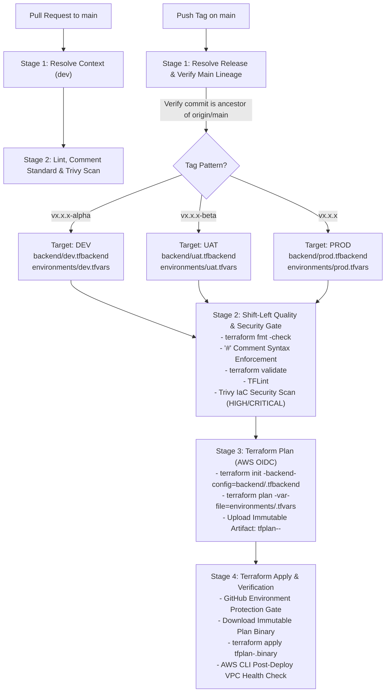

# `okk-infra` — AWS Three-Tier VPC & CI/CD Pipeline

Production-grade Terraform Infrastructure as Code (IaC) and automated GitHub Actions CI/CD pipeline for the **`okk-infra`** AWS networking layer (Public, Private, and isolated Database subnet tiers across 3 Availability Zones).

---

## 1. Repository Structure

```text
.
├── .github/
│   └── workflows/
│       └── terraform-cicd.yml      # GitHub Actions 4-stage CI/CD pipeline
├── backend/
│   ├── dev.tfbackend               # S3 state + native S3 lockfile config for DEV
│   ├── uat.tfbackend               # S3 state + native S3 lockfile config for UAT
│   └── prod.tfbackend              # S3 state + native S3 lockfile config for PROD
├── environments/
│   ├── dev.tfvars                  # DEV variables (10.0.0.0/16, Single NAT GW)
│   ├── uat.tfvars                  # UAT variables (10.1.0.0/16, Single NAT GW)
│   └── prod.tfvars                 # PROD variables (10.2.0.0/16, Multi-AZ HA NAT GW)
├── modules/
│   └── vpc/                        # Reusable 3-tier VPC module
│       ├── main.tf
│       ├── variables.tf
│       ├── outputs.tf
│       ├── versions.tf
│       └── README.md
├── .pre-commit-config.yaml         # Local pre-commit hooks & comment standards
├── .tflint.hcl                     # TFLint rules enforcing '#' comments & docs
├── main.tf                         # Root module invoking ./modules/vpc
├── outputs.tf                      # Root outputs
├── variables.tf                    # Root input variable definitions
└── versions.tf                     # Terraform, AWS provider & S3 backend (use_lockfile = true)
```

---

## 2. CI/CD Pipeline Architecture & Flow

All environment deployments (`dev`, `uat`, `prod`) are driven strictly from the **`main`** branch using **Semantic Version Git Tags** and **Immutable Terraform Plan Artifacts**.



---

## 3. Tag-to-Environment Promotion Matrix

Every environment is deployed from commits on the `main` branch. Promoting infrastructure across environments simply requires tagging the verified commit SHA on `main`:

| Git Tag Pattern | Example Tag | Target Environment | Backend Config | Variable File | NAT Gateway Topology |
| :--- | :--- | :--- | :--- | :--- | :--- |
| `v*.*.*-alpha` | `v1.0.0-alpha` | **DEV** | `backend/dev.tfbackend` | `environments/dev.tfvars` | Single Shared NAT GW |
| `v*.*.*-beta` | `v1.0.0-beta` | **UAT** | `backend/uat.tfbackend` | `environments/uat.tfvars` | Single Shared NAT GW |
| `v*.*.*` | `v1.0.0` | **PROD** | `backend/prod.tfbackend` | `environments/prod.tfvars` | Multi-AZ HA NAT GWs (1 per AZ) |

---

## 4. Pipeline Execution Stages

### Stage 1: Resolve Release & Verify `main` Branch Lineage (`resolve-context`)
* **Lineage Guardrail**: Runs `git merge-base --is-ancestor "${{ github.sha }}" origin/main`. If a tag is pushed on a commit that has **not** been merged into `main`, the pipeline fails immediately.
* **Dynamic Routing**: Parses the tag (`-alpha`, `-beta`, or stable release) and exports `target_env`, `tfvars_file`, and `backend_file` to downstream stages.

### Stage 2: Shift-Left Quality, Comment Standard & Security Gate (`lint-and-scan`)
Blocks any unformatted, undocumented, or insecure code before AWS credentials are ever requested:
1. **`terraform fmt -check -recursive`**: Enforces canonical HCL formatting.
2. **Comment Syntax Check**: Rejects `//` or `/* */` comments in `.tf` and `.tfvars` files, enforcing `#` comments only.
3. **`terraform validate`**: Validates resource consistency and variable types.
4. **`tflint`**: Enforces `.tflint.hcl` rules (`terraform_comment_syntax`, `terraform_documented_variables`, `terraform_documented_outputs`, `terraform_naming_convention`).
5. **Trivy IaC Security Scan**: Scans all Terraform files for `HIGH` and `CRITICAL` AWS misconfigurations.

### Stage 3: Immutable Terraform Plan (`plan`)
* Authenticates with AWS using short-lived **GitHub OIDC credentials** (`aws-actions/configure-aws-credentials@v4`).
* Initializes the S3 backend with native S3 lockfile state locking (`use_lockfile = true`) using `backend/<env>.tfbackend`.
* Generates a deterministic binary plan (`tfplan-<env>.binary`) using `environments/<env>.tfvars` and uploads it as an immutable artifact (`tfplan-<env>-<sha>`).

### Stage 4: Gated Terraform Apply & Post-Deploy Verification (`apply`)
* **Concurrency Control**: Ensures only one `apply` runs per environment at a time (`cancel-in-progress: false`).
* **Environment Protection Rules**: Targets the GitHub Environment (`dev`, `uat`, or `prod`), enabling required manual approvals prior to production changes.
* **Immutable Execution**: Downloads the exact `tfplan-<env>.binary` generated in Stage 3 and applies it without re-calculating the plan.
* **Post-Deployment Smoke Test**: Queries the AWS EC2 API (`aws ec2 describe-vpcs`) to verify the provisioned VPC state is `available`.

---

## 5. Pre-Commit & Comment Standards

Local quality gates are defined in `.pre-commit-config.yaml` and `.tflint.hcl` to catch issues before commits are pushed.

### Enforced Rules
1. **Hash (`#`) Comment Standard**: Only `#` comments are permitted in `.tf` and `.tfvars` files (`//` and `/* */` are blocked by both `terraform-comment-standard` and TFLint's `terraform_comment_syntax`).
2. **Mandatory Variable & Output Descriptions**: Every `variable` and `output` block must contain an explicit `description` attribute.
3. **Conventional Commit Messages**: Commit messages are validated during the `commit-msg` hook and must follow the `<type>(<scope>): <description>` standard (`feat`, `fix`, `chore`, `docs`, `refactor`, `test`, `ci`, `perf`, `build`, `revert`).
4. **Automated Module Docs**: `terraform_docs` keeps `README.md` input/output tables synchronized.

### Local Setup

```bash
# 1. Install pre-commit hooks for both code changes and commit messages
pre-commit install
pre-commit install --hook-type commit-msg

# 2. Run all hooks manually against the repository
pre-commit run --all-files
```

---

## 6. GitHub Repository Setup Prerequisites

### 1. AWS S3 Backend Prerequisites (Native S3 State Locking)
Provision the S3 state buckets (with versioning, AES256/KMS encryption, and public access blocked). State locking uses native S3 conditional writes (`use_lockfile = true` creating `.tflock` objects in S3), so DynamoDB tables are not required:
* **DEV**: Bucket `okk-infra-tfstate-dev`
* **UAT**: Bucket `okk-infra-tfstate-uat`
* **PROD**: Bucket `okk-infra-tfstate-prod`

### 2. GitHub Environments
Configure the following environments under **Settings $\rightarrow$ Environments**:
* `dev-plan` & `dev`
* `uat-plan` & `uat`
* `prod-plan` & `prod` *(Recommended: Enable **Required Reviewers** and restrict deployment branches/tags on `prod`)*

### 3. GitHub Actions Repository Secrets (OIDC IAM Roles)
Configure the IAM Role ARNs trusted by GitHub's OIDC provider (`token.actions.githubusercontent.com`):
* `AWS_ROLE_ARN_DEV`
* `AWS_ROLE_ARN_UAT`
* `AWS_ROLE_ARN_PROD`

---

## 7. Release & Deployment Runbook

### Step 1: Develop & Open a Pull Request
```bash
git checkout -b feat/vpc-update
# Make changes, format, and commit following Conventional Commits
git add .
git commit -m "feat(vpc): configure three-tier subnets for okk-infra"
git push origin feat/vpc-update
```
Opening a PR against `main` automatically runs **Stage 1** and **Stage 2** (Formatting, Comment Standard, Validation, TFLint, and Trivy Security Scan).

### Step 2: Merge to `main` & Deploy to DEV (`v*.*.*-alpha`)
```bash
git checkout main
git pull origin main

git tag v1.0.0-alpha
git push origin v1.0.0-alpha
```

### Step 3: Promote to UAT (`v*.*.*-beta`)
Once verified in `dev`, tag the same `main` commit for `uat`:
```bash
git tag v1.0.0-beta
git push origin v1.0.0-beta
```

### Step 4: Promote to PROD (`v*.*.*`)
Once signed off in `uat`, tag the same `main` commit for `prod`:
```bash
git tag v1.0.0
git push origin v1.0.0
```

---

## 8. Local CLI Usage (Manual Inspection)

To initialize and run `terraform plan` locally against a specific environment:

```bash
# Initialize with target environment backend
terraform init -reconfigure -backend-config=backend/dev.tfbackend

# Plan with target environment variables
terraform plan -var-file=environments/dev.tfvars
```
